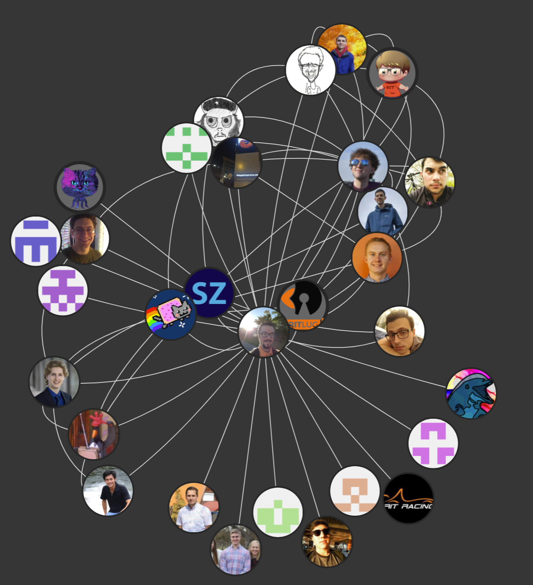

# Github-Graphs

Website for visualizing a persons github network.



If you are lucky, you can find the site live [here](https://github-graphs.com/).

## Built With

- [BootStrap](https://getbootstrap.com/)
- [jQuery](https://jquery.com/)
- [Vis JS](http://visjs.org/)
- [Github v3 API](https://developer.github.com/v3/)
- [Node.js](https://nodejs.org/en/)


## Deployment

The easiest way to get started with Github-Graphs is to fork this repository
and follow the instructions below.

#### Create a GitHub Personal Access Token (PAT)

Authentication is handled via a GitHub Personal Access Token (PAT). The old
OAuth App `client_id`/`client_secret` query parameter method is no longer used,
as GitHub deprecated unauthenticated and OAuth-param-based requests.

To create a PAT:
1. Go to **GitHub → Settings → Developer settings → Personal access tokens**
2. Choose **Fine-grained tokens** (recommended) or **Tokens (classic)**
3. For a classic token, grant the `public_repo` and `read:user` scopes (read-only is sufficient)
4. Copy the generated token — it will only be shown once

#### Create a .env file

After forking this repository, run the command `cd server/`. Inside that folder,
setup your environment credentials by creating a `.env` file with the values below filled in.

```
GITHUB_TOKEN = <your_personal_access_token>
SESSION_SECRET = <any_string_you_want>
PORT = <any_number>
```

The creation of your PAT and the `.env` file are required steps,
irrespective of your desired deployment environment. For specific directions,
continue by following the steps specified below.

### Deployment on the local machine

#### Install dependencies

Dependencies are installed using `npm`. Therefore, please install the package manager
before proceeding. If you already have `npm` installed, run the command below inside
`server/` in order to install the dependencies in the package directory.

```bash
npm install
```

#### Explore GitHub-Graphs

Inside `server/`, run the following command to start the program, and in your
browser, check `localhost:8000` to visualize your Github network.

```bash
node server.js
```

### Deployment in a Docker container

Github-graphs can also be deployed inside a docker container and displayed in
your browser through port mapping. To get started run the following commands
inside your forked repository.

The easiest way to deploy in a docker container is through the use of our proposed
`docker-compose.yml` file. If you choose this methodology, make sure the port numbers
in your `.env` file matches the docker-compose file. Note that this approach will work
only on systems which have Docker and Docker-compose both installed.
Considering the example provided in our provided docker-compose,
the port number of the .env file should be `PORT= 8000`. Therefore, you could
visualize the Github-Graphs page at `localhost:8080` after running:

```
    docker-compose up -d --build
```

In order to clean the environment, you can run the following command.

```
    docker-compose down --rmi all

```

Besides the use of docker-compose, deployment with just docker is possible with the following commands:\

```
    docker build -t <choose_name_for_image> .
    docker run -d --name <choose_name_for_container> -p <local_port_num>:<port_num_from_env_file> <name_of_image>
```

For instance, assume I name my image `graph-app`, my container `github-graphs`,
and set the port number in my .env file to `8000`, I can decide to listen on my localhost at port `8080`.
Therefore, my commands are:

```
    docker build -t graph-app .
    docker run -d --name github-graphs -p 8080:8000 graph-app
```

If you are willing to read the debugging statement on the CLI, do not add `-d` to the `docker run` statement.

At this step, you can now visualize Github graphs at `localhost:<local_port_num>`.


## Contributing

We are very open to new contributors. If you want to contribute to this project,
and don't know where to start, look at the [open issues](https://github.com/jrtechs/github-graphs/issues).
Once you know what you want to work on, comment on the issue and file a pull request.

## API Reference

`GET https://github-graphs.com/api/friends/<username>`

Fetches `https://api.github.com/users/<username>/followers` [(GitHub Reference)](https://developer.github.com/v3/users/followers/#list-followers-of-a-user)
and `https://api.github.com/users/<username>/following` [(GitHub Reference)](https://developer.github.com/v3/users/followers/#list-users-followed-by-another-user)
to generate an array of users following `<username>` and that `<username>` follows each with values `login` and `avatar_url`.

Example result:

```json
[
  {
    "login": "jrtechs",
    "avatar_url": "https://avatars1.githubusercontent.com/u/13894625?s=460&v=4"
  }
]
```

---

`GET https://github-graphs.com/api/repositories/<username>`

Fetches `https://api.github.com/users/<username>/repos` and returns an array of the repositories `<username>` owns.

Example result:

```json
[
  {
    "name": "bash_manager",
    "created_at": "2017-09-27T14:38:01Z",
    "homepage": "",
    "description": "Python scripts I use to manage my ssh connections, drive mounts, and other bash related things. ",
    "language": "Python",
    "forks": 26,
    "watchers": 4,
    "open_issues_count": 7,
    "license": {
      "key": "mpl-2.0",
      "name": "Mozilla Public License 2.0",
      "spdx_id": "MPL-2.0",
      "url": "https://api.github.com/licenses/mpl-2.0",
      "node_id": "MDc6TGljZW5zZTE0"
    },
    "html_url": "https://github.com/jrtechs/bash_manager"
  }
]
```

---

`GET https://github-graphs.com/api/org/users/<organization_name>`

Fetches `https://api.github.com/orgs/<organization_name>/members` [(GitHub Reference)](https://developer.github.com/v3/orgs/members/#members-list)
to generate an array of users that are in `<organization_name>` each with values `login` and `avatar_url`.

Example result:

```json
[
  {
    "login": "jrtechs",
    "avatar_url": "https://avatars1.githubusercontent.com/u/13894625?s=460&v=4"
  }
]
```

---

`GET https://github-graphs.com/api/org/repositories/<organization_name>`

Fetches `https://api.github.com/orgs/<organization_name>/repos` [(GitHub Reference)](https://developer.github.com/v3/repos/#list-organization-repositories)
to return an array of repositories `<organization_name>` owns.

Example result:

```json
[
  {
    "name": "vue",
    "created_at": "2013-07-29T03:24:51Z",
    "homepage": "http://vuejs.org",
    "description": "🖖 Vue.js is a progressive, incrementally-adoptable JavaScript framework for building UI on the web.",
    "language": "JavaScript",
    "forks": 23228,
    "watchers": 154891,
    "open_issues_count": 419,
    "license": {
      "key": "mit",
      "name": "MIT License",
      "spdx_id": "MIT",
      "url": "https://api.github.com/licenses/mit",
      "node_id": "MDc6TGljZW5zZTEz"
    },
    "html_url": "https://github.com/vuejs/vue"
  }
]
```
